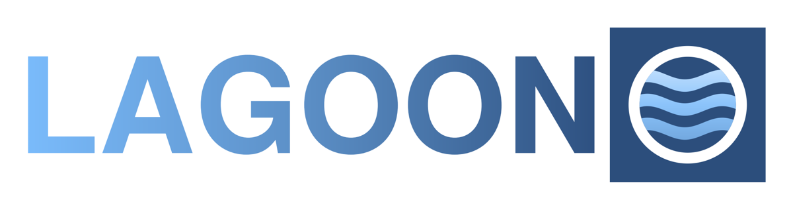
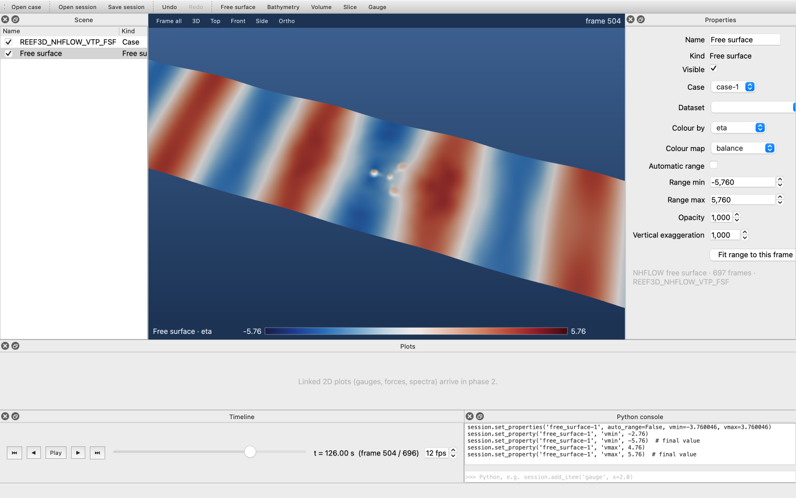

<p align="center"></p>

**LAGOON: Lightweight Animation and Graphics for Open Ocean Numerics.**
An open-source desktop application for exploring, plotting and rendering ocean and
coastal simulations, in the spirit of ParaView and Blender but built for
hydrodynamics. Part of the [REEF3D](https://github.com/REEF3D) family.

> Status: **phase 1, viewer (in progress).** LAGOON opens REEF3D runs (NHFLOW, FNPF,
> CFD VTU/PVTU output), shows the free surface, bed and volume in a GPU viewport and
> plays them over time. See `docs/LAGOON implementation plan.pdf` for what comes next.

<p align="center"></p>

## Run it

With [pixi](https://pixi.sh) (recommended, identical environment on every machine):

```bash
pixi run lagoon        # start the application
pixi run test          # run the tests
pixi run lint          # ruff + layer rules
```

With pip in any Python 3.11+ environment:

```bash
pip install -e ./lagoon-format -e ".[dev]"
lagoon                 # or: python -m lagoonviz
pytest
```

## Open a REEF3D run

*File → Open case…* and pick the folder the run wrote its `REEF3D_*` folders into
(or one of those folders, or a single `.pvtu`/`.pvtp` file). From a terminal:

```bash
lagoon ~/runs/seamount                    # a case folder
lagoon ~/runs/seamount/REEF3D_NHFLOW_VTP_FSF
lagoon figure.lagoon-session              # a saved session
```

In the viewport: left drag rotates, right drag (or Shift + drag) pans, the wheel
zooms. Blender's middle-mouse navigation works too, and the number keys choose views:
1 front, 3 side, 7 top (with Ctrl the opposite side), 5 perspective/orthographic,
Home frames everything. The timeline plays and scrubs through the frames; frames are
read in the background and kept in memory, so stepping back is instant.

The same view renders without a screen, e.g. on a cluster:

```bash
lagoon-render ~/runs/seamount frame.png --time 120 --size 1920x1080
lagoon-render figure.lagoon-session figure.png
```

## Layout

| Path | What | License |
| --- | --- | --- |
| `src/lagoonviz/core` | Scene, commands, sessions, REEF3D readers. No Qt, no GPU. | GPLv3 |
| `src/lagoonviz/render` | pygfx 3D scene and offscreen rendering (matplotlib later) | GPLv3 |
| `src/lagoonviz/gui` | PySide6 application | GPLv3 |
| `src/lagoonviz/plugins` | Readers and tools for other codes (later) | GPLv3 |
| `lagoon-format/` | LAGOON data format: specification and reference reader/writer | MIT |

The layer rules (core never imports Qt, render never imports the GUI, the format
library never imports the application) are checked in CI with `lint-imports`.

## Scripting

Everything the GUI does goes through `lagoonviz.core.Session`, so it can be scripted
and replayed headless:

```python
from lagoonviz.core import Session

session = Session()
session.open_case("~/runs/seamount")            # adds the case, free surface and bed
session.set_property("free_surface-1", "exaggeration", 8.0)
session.set_time(120.0)
session.save("seamount.lagoon-session")
print(session.to_script())  # the history as a runnable script

mesh = session.data.load("free_surface-1")      # NumPy arrays of the current frame
print(mesh.points.shape, mesh.point_data["eta"].max())
```

In the application, *File → Export script* writes the same script, and the Python
console shows every command as it runs.

## License

The LAGOON application is licensed under the GNU General Public License v3.0 or
later (`LICENSE`). The data format package in `lagoon-format/` is MIT-licensed
(`lagoon-format/LICENSE`) so that other codes can read and write the format freely.
